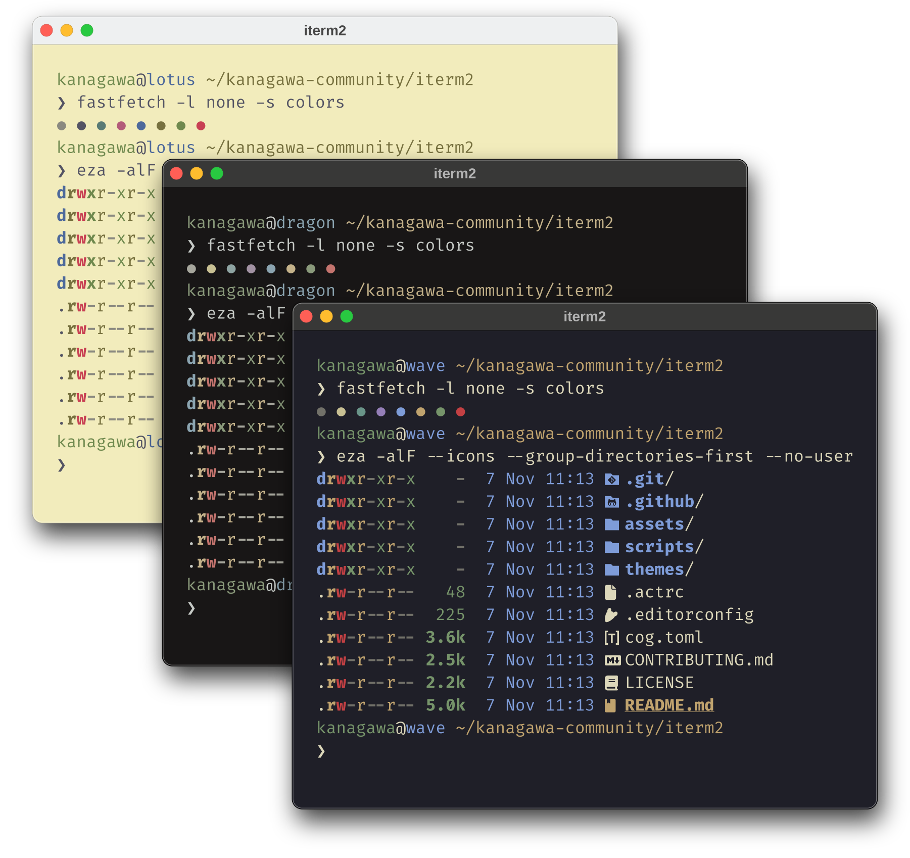
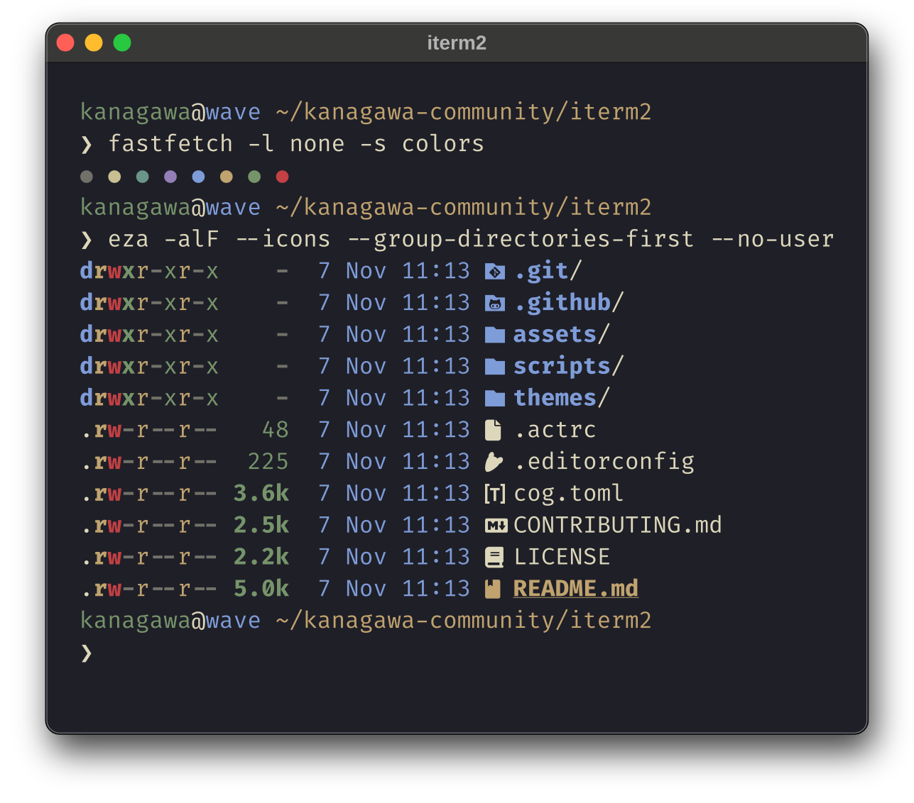
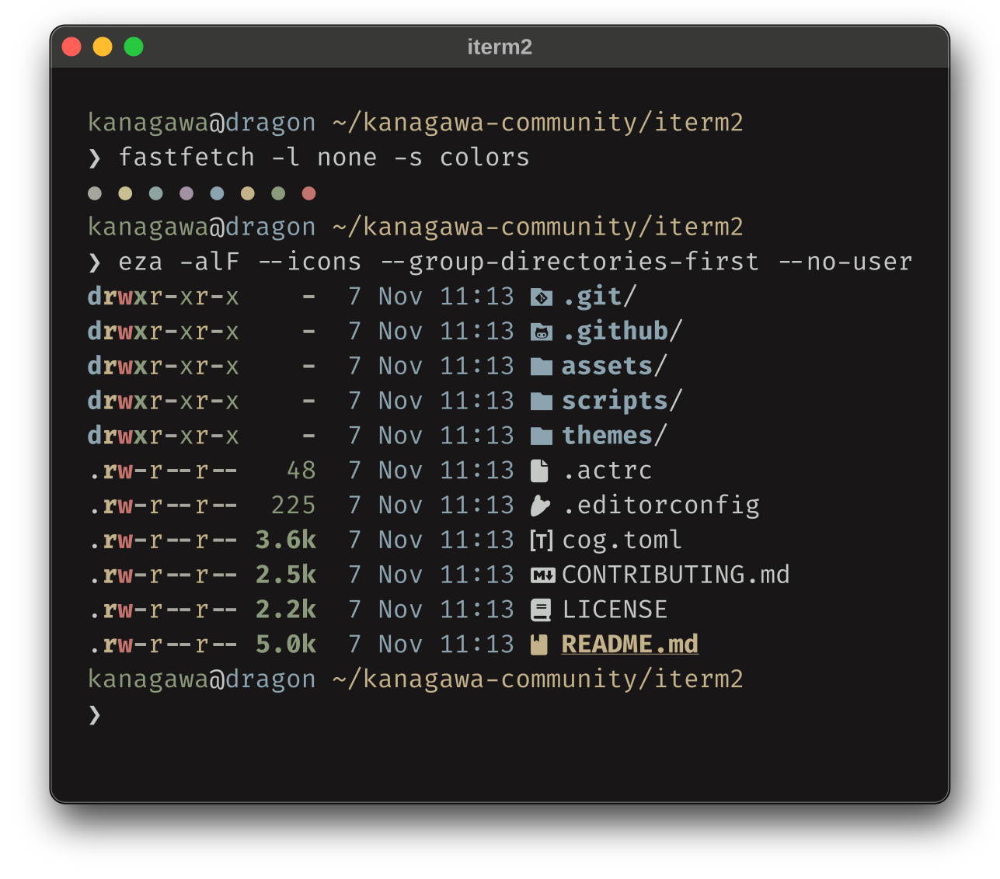
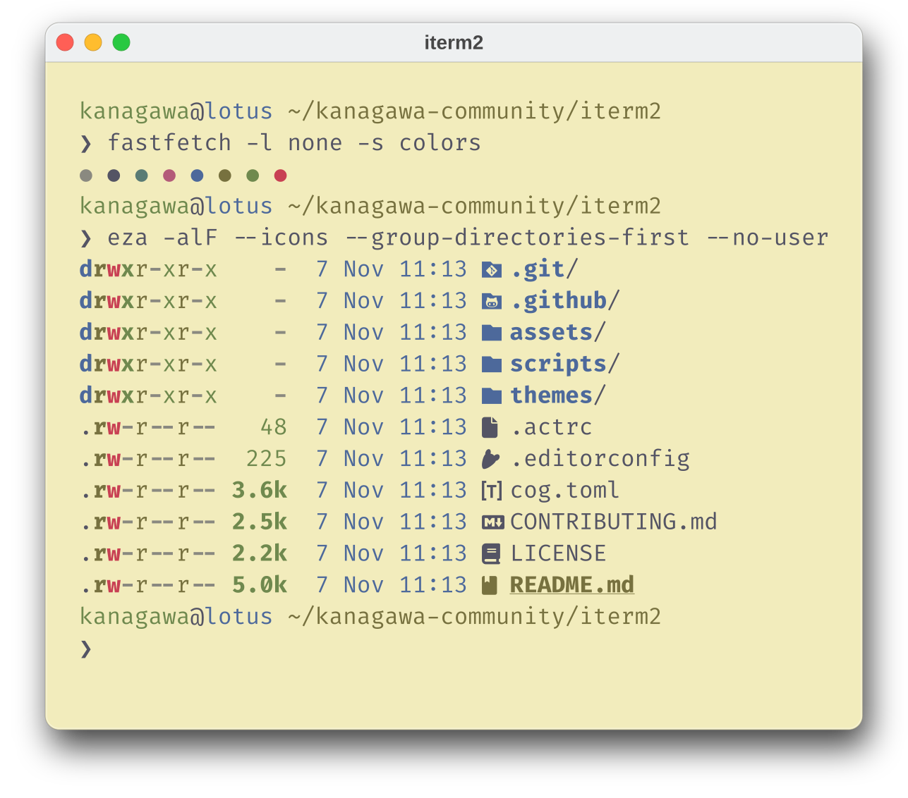

<h3>Kanagawa for <a href="https://iterm2.com/">iTerm2</a></h3>

A community-maintained theme inspired by Hokusai's <em>The Great Wave off Kanagawa</em>.

Using the <a href="https://github.com/rebelot/kanagawa.nvim">Kanagawa palette</a> by <a href="https://github.com/rebelot">Tommaso Laurenzi (rebelot)</a>.

<!-- Wave accents: carpYellow, crystalBlue, autumnRed. Lotus accents: lotusYellow, lotusBlue4, lotusRed. -->

  <a href="https://github.com/kanagawa-community/iterm2/stargazers">
    <picture>
      <source media="(prefers-color-scheme: dark)" srcset="https://img.shields.io/github/stars/kanagawa-community/iterm2?style=for-the-badge&amp;labelColor=1F1F28&amp;color=E6C384">
      <source media="(prefers-color-scheme: light)" srcset="https://img.shields.io/github/stars/kanagawa-community/iterm2?style=for-the-badge&amp;labelColor=F2ECBC&amp;color=77713F">
      
    </picture>
  </a>
  <a href="https://github.com/kanagawa-community/iterm2/releases/latest">
    <picture>
      <source media="(prefers-color-scheme: dark)" srcset="https://img.shields.io/github/v/release/kanagawa-community/iterm2?style=for-the-badge&amp;label=release&amp;labelColor=1F1F28&amp;color=7E9CD8">
      <source media="(prefers-color-scheme: light)" srcset="https://img.shields.io/github/v/release/kanagawa-community/iterm2?style=for-the-badge&amp;label=release&amp;labelColor=F2ECBC&amp;color=4D699B">
      
    </picture>
  </a>
  <a href="https://github.com/kanagawa-community/iterm2/issues">
    <picture>
      <source media="(prefers-color-scheme: dark)" srcset="https://img.shields.io/github/issues/kanagawa-community/iterm2?style=for-the-badge&amp;labelColor=1F1F28&amp;color=C34043">
      <source media="(prefers-color-scheme: light)" srcset="https://img.shields.io/github/issues/kanagawa-community/iterm2?style=for-the-badge&amp;labelColor=F2ECBC&amp;color=C84053">
      
    </picture>
  </a>

 
 

## Previews

The images are rendered from the palette's terminal colors, the same values
that this theme sets.

🌊 Wave

🐉 Dragon

🪷 Lotus

## Requirements

- iTerm2 3.0 or later, on macOS.

## Installation

Download the theme for your variant from [`themes/`](themes/), then open it. iTerm2 imports it as a color preset.

## Usage

In **Settings > Profiles > Colors**, open **Color Presets** and choose the Kanagawa preset.

## Palette

Every color comes from the shared
[palette](https://github.com/kanagawa-community/.github/blob/main/docs/PALETTE.md),
picked by role, so each variant uses its own value for the same role.

| iTerm2 color                                            | Palette role   |
| ------------------------------------------------------- | -------------- |
| `Background Color`, `Cursor Text Color`                 | `ui.bg`        |
| `Foreground Color`, `Bold Color`, `Selected Text Color` | `ui.fg`        |
| `Cursor Color`                                          | `ui.fg_dim`    |
| `Selection Color`                                       | `ui.bg_visual` |
| `Ansi 0 Color` to `Ansi 15 Color`                       | `term.*`       |
| `Link Color`                                            | `syn.fun`      |
| `Badge Color`                                           | `ui.nontext`   |

## Credits

This port replaces the iTerm2 theme in the `extras` folder of the
[Neovim plugin](https://github.com/kanagawa-community/neovim). Jose Alvarez first contributed that theme to kanagawa.nvim. The
colors come from [kanagawa.nvim](https://github.com/rebelot/kanagawa.nvim) by
Tommaso Laurenzi.

## Issues and contributions

Report bugs and request changes in this port's
[issue tracker](https://github.com/kanagawa-community/iterm2/issues). Contributions are welcome.

See [CONTRIBUTING.md](CONTRIBUTING.md) before opening a pull request.

## License

MIT. See [LICENSE](LICENSE).
